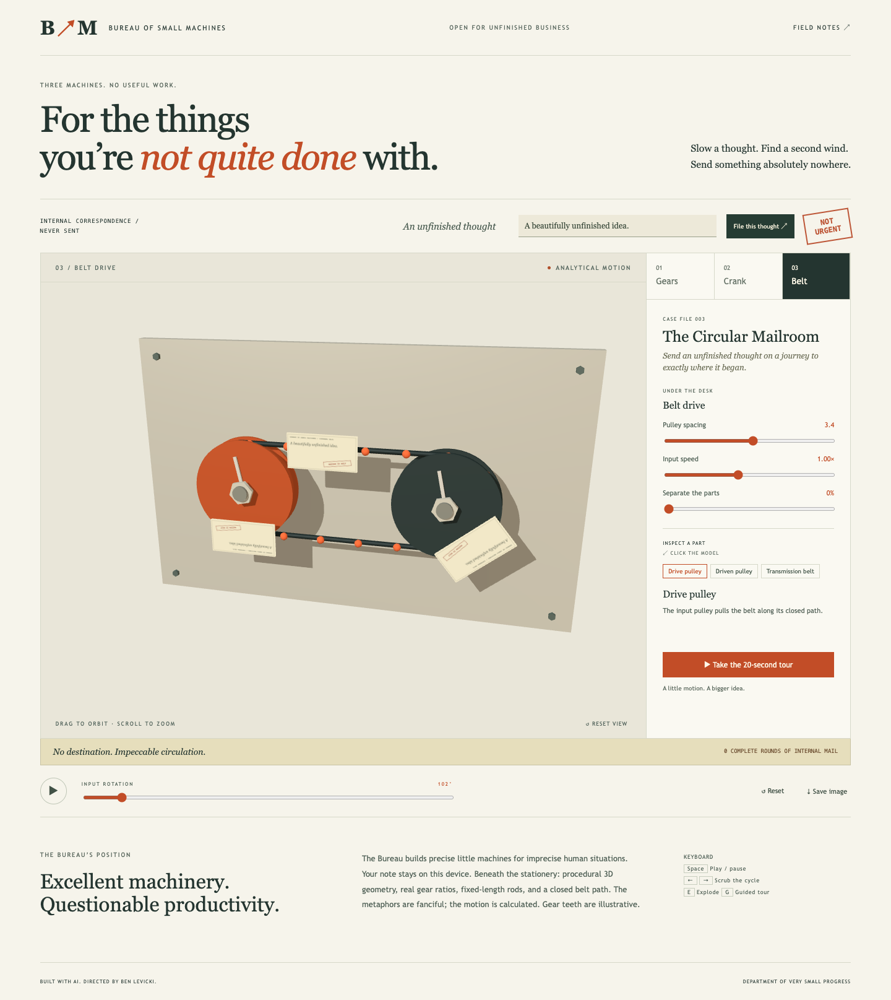
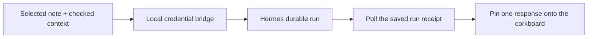

# Afterthought — Machine Stories

Leave a thought on a corkboard. Sketch the architecture. Draw the thing you can’t quite explain. When connected to your own Hermes Agent, leave it some homework and receive a response back on the board.

[Open the notebook](https://bblevick.github.io/machine-stories/) · [50-second walkthrough](docs/media/demo.mp4) · [Specification](SPEC.md) · [Verification](docs/VERIFICATION.md)



## Three ways to think

- **Corkboard:** movable sticky notes, colors, brain dumps, local autosave, undo/redo, JSON board transfer and PNG snapshot. Starter notes are explicitly labeled. Notes are sent only by clicking the Hermes button.
- **Diagram:** movable process/decision/database/storyboard blocks, directed and labeled connectors, architecture/storyboard starters, keyboard editing and SVG export.
- **Whiteboard:** a portrait 1100×1600 paper page for mouse, touch or pen. Pressure-sensitive strokes, coalesced pointer samples, vector eraser, ink weight/color, undo, PNG export, and an expanded view. Touch can be disabled while using a pen. Unrelated palm/touch pointers cannot finish the active pen stroke. Real iPad/Pencil hardware remains untested.

No application framework, drawing service, font CDN, accounts or API keys for the notebook. Original HTML/CSS/SVG/Canvas. Boards save to this browser on this device; they are not cloud-synced. Export a JSON copy for another device or a backup.

## Run the notebook

Node 24 LTS and npm:

```sh
npm ci
npm run dev
npm run typecheck
npm test
npm run test:bridge
npx playwright install chromium webkit
npm run test:e2e
npm run build
npm run preview
```

## Connect your own Hermes Agent

Hermes is **not installed or bundled** in this repository. No live agent run has been claimed for this machine. The UI has a setup guide and stays disconnected until your real gateway is available. API-contract tests use explicitly named fixtures, not an invented live agent.

1. Install Hermes using its [official installation guide](https://hermes-agent.nousresearch.com/docs/getting-started/installation), then run `hermes setup` to choose your model provider and tools. Provider credentials, permissions and any charges belong to that separate setup.
2. Enable its [API server](https://hermes-agent.nousresearch.com/docs/user-guide/features/api-server): set `API_SERVER_ENABLED=true` and a strong `API_SERVER_KEY` in your Hermes configuration; start `hermes gateway`.
3. In this repository, copy `.env.example` to `.env.local`. Set `HERMES_API_KEY` to the same gateway key. The default `HERMES_URL` is `http://127.0.0.1:8642`.
4. Run `npm run board`, open **http://127.0.0.1:4198/**, then choose **Hermes → Check local connection**.

The bridge binds only to 127.0.0.1:8766 and holds the credential server-side. It forwards only the documented Hermes run endpoints through Vite. The published Pages notebook never tries to contact your local machine. Your note and selected attachments go through your configured Hermes provider/tools only when you explicitly send them.

Hermes receives the selected note and, if checked, the diagram text/links or whiteboard stroke coordinates. Stroke coordinates are **not handwriting recognition or image understanding**. No automatic whole-board upload. No credential in a `VITE_` variable, local storage, bundle or export.

## What happens while Hermes works



The request snapshot and random idempotency key save before submission. A lost creation response can be recovered with that same key and payload; the board never silently submits a fresh task. Run IDs survive reloads. Each completed run can create one linked response note; repeated polls do not duplicate it. Polling resumes after reconnecting locally. The original note stays intact.

Failed, cancelled, interrupted, unknown and partial states remain distinct. A stop request stays **stopping** until the gateway confirms a terminal state. A missing final response is not marked successful. Approvals/clarifications and unknown-execution recovery belong in Hermes’s own interface; the board never auto-approves tool calls. Gateway retention and idempotency limits still apply; this is not a global exactly-once guarantee.

## Architecture and limits

`src/board/model.ts` defines bounded board data, snapshots, validation and run reconciliation. `drawing.ts` renders original SVG, paper ink and PNG snapshots. `main.ts` handles the three interfaces, pointer input, local persistence and run polling. `server/bridge.mjs` is a small allowlisted local HTTP proxy; no agent framework, shell execution or hosted agent service.

80 notes, 50 diagram blocks, 100 connectors, 500 strokes, 100,000 ink points, 3 MB board files. Replies preserve up to 20,000 characters. Undo history is session-local (20 snapshots); current content persists. Run receipts are kept across undo so a UI edit does not forget active work. Exported PNG snapshots are visual summaries; JSON is the complete editable board. No real-time collaboration, multi-user hosting, remote gateway exposure, OCR, or native Apple Pencil guarantee.

## Documentation and demonstration

See [BUILD_LOG.md](BUILD_LOG.md) and [TASKS.md](TASKS.md). Recreate media with `npm run demo:capture` (FFmpeg required). Original code/assets are [MIT licensed](LICENSE); [notices](THIRD_PARTY_NOTICES.md).
