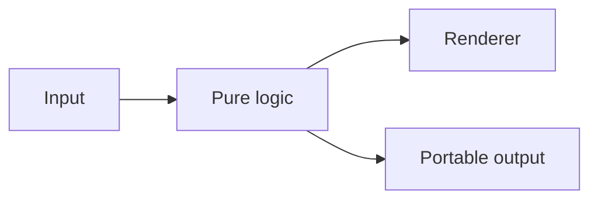

# Machine Stories — Bureau of Small Machines

File an unfinished thought into a mechanical mailroom that sends it precisely nowhere.

[Open the live demo](https://bblevick.github.io/machine-stories/) · [Watch the 50-second demonstration](docs/media/demo.mp4) · [Build specification](SPEC.md) · [Verification](docs/VERIFICATION.md)


## The Bureau

The Patience Regulator, Second-Wind Engine, and Circular Mailroom turn analytical mechanisms into a small absurd office. Enter a note to place it on real moving 3D stationery. The note stays in browser memory and is not transmitted or saved by the application. Bellows geometry follows the slider; mail follows the full belt path. The metaphors are playful; the kinematics remain analytical.

## What you can do

- Three procedural mechanisms: spur gears, slider–crank, and equal-pulley belt drive.
- Orbit and zoom, pause and cycle scrubbing, adjustable parameters, exploded views, and keyboard-accessible part inspection.
- A 20-second guided tour that returns control to the visitor, plus PNG export.

## Run locally

Use Node 24 LTS (`.nvmrc`) and npm. No API keys, accounts, or application backend are required.

```sh
npm ci
npm run dev
```

Open the local URL Vite prints. Downloads are needed for dependencies and initial asset preparation; application computation stays in the browser.

```sh
npm run typecheck
npm test
npx playwright install chromium webkit
npm run test:e2e
npm run build
npm run preview
```

## How it works

**Three.js · TypeScript · Vite**



Controls → bounded mechanism config → analytical poses → procedural Three.js scene.

## Mechanism interface

`MechanismConfig` selects `gears | crank | belt`. Ratios are 1, 2, or 3; crank radius is 0.4–1; rod length is 1.5–3.5 and exceeds radius; pulley spacing is 2.2–4.5; speed is 0.25–2. Units are illustrative scene units. Phase is measured in input revolutions.

`sampleMechanism` returns named `{x, y, angle}` part poses, with angles in radians. Gear centers are separated by summed pitch radii. Driven angle is the negative input angle divided by ratio, plus a fixed assembly offset. Slider position is `r cos θ + sqrt(L² − r² sin² θ)`. Belt markers traverse two straight spans and two semicircles.

`Exhibit.renderAt(timeMs, viewState)` combines config, phase, exploded offset, and guided-tour state. Time is supplied through phase in `viewState`; render calls do not advance simulation. `window.machineStories` exposes deterministic capture helpers used by browser checks and media scripts.

## Controls

Space toggles play, arrows scrub, E toggles separation, and G starts the tour when focus is outside a control. Visible part buttons provide keyboard equivalents for clicking geometry. The Reset button restores the default gear exhibit and pauses it.

## How I built this with AI

Ben selected the project mix, approved the scope, and set the free/local and smaller-model handoff constraints. Codex generated and iterated the implementation, tests, documentation, and demo tooling from that approved brief. This repository is an AI-assisted build; it does not imply that every line was hand-written by Ben.

The development workflow separated pure logic from rendering, used bounded tickets, exercised browser behavior, and corrected failures found during verification. See [BUILD_LOG.md](BUILD_LOG.md) for actual fixes and [TASKS.md](TASKS.md) for the implementation sequence. The app uses deterministic runtime logic; AI assisted development rather than live generation.

## Recreate the demonstration

```sh
# Requires FFmpeg on PATH and Playwright Chromium installed.
npm run demo:capture
```

This records a scripted, real browser walkthrough and creates `docs/media/demo.mp4`. It uses a temporary local port (4201) and requires approximately one minute. Raw captures stay in ignored `.artifacts/`. The demonstration has no narration or audio track.

## Limits

Simplified educational geometry. Gear teeth are illustrative; no manufacturing tolerances, contact forces, CAD import, or physical collision solver. The gear pair returns to its complete joint pose after the larger gear’s ratio of input revolutions.

[Measured local performance](docs/performance.json) reports a bounded headless-browser frame-scheduling sample, not a guarantee across devices.

## Deployment and license

GitHub Actions runs unit/browser checks, builds with the repository base path, and deploys to GitHub Pages. See [Publishing](docs/PUBLISHING.md).

Original code: [MIT](LICENSE). Bundled third-party code, models, and source data retain their own terms; see [notices](THIRD_PARTY_NOTICES.md).
